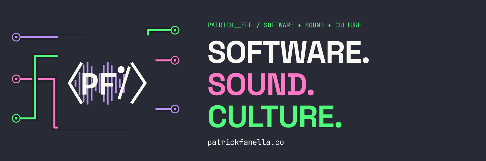

# Patrick Fanella / Patrick__eff

I'm Patrick Fanella, a senior full-stack and backend engineer in Chicago. I build web products and the systems behind them, with a focus on search, media, and tools for independent culture.

At DeliverZero, I built inventory, returns, and partner integrations across three markets, reducing manual operational work by approximately 25%. Through [SUBCULT](https://github.com/subculture-collective), I build products for finding clips, searching recording archives, making music visuals and running community projects. The source for all of them is public.

**Open to senior full-stack, backend, and product engineering roles.**

[Portfolio](https://patrickfanella.co) · [Resume](https://patrickfanella.co/resume) · [LinkedIn](https://www.linkedin.com/in/patrick-fanella/) · [Email](mailto:patrick@subcult.tv)

**Core stack:** Go · Python · TypeScript · React · PostgreSQL · PostGIS · OpenSearch · Docker · Kubernetes

### Featured work

- **[clpr](https://github.com/subculture-collective/clpr)**: find Twitch clips by creator, topic and tag, and keep playlists to share. Go, React, PostgreSQL and hybrid search. [clpr.tv](https://clpr.tv)
- **[HasanAra](https://github.com/subculture-collective/hasanara)** on **[Rekolekt](https://github.com/subculture-collective/rekolekt)**: search years of broadcasts by phrase and open each result at its timestamp. FastAPI, React, GPU transcription, PostgreSQL and OpenSearch. Transcripts are automatic, so check the recording before quoting. [hasanara.tv](https://hasanara.tv)
- **[Headcount](https://github.com/subculture-collective/headcount)**: scores the Twitch top 200 for bot-like viewer and chat patterns. Go, TimescaleDB and statistical scoring. A signal, not proof. [headcount.subcult.tv](https://headcount.subcult.tv/)
- **[Undertow](https://github.com/subculture-collective/undertow)**: a layered music visualizer with timed lyrics that exports MP4 in the browser. [undertow.subcult.tv](https://undertow.subcult.tv)

Product screenshots

**clpr: clip discovery**

**Undertow: layered music editor**

**HasanAra: a Rekolekt archive**

### Products and apps

- **[Kork](https://github.com/subculture-collective/kork)**: free link pages; payment buttons go to your own accounts. [kork.subcult.tv](https://kork.subcult.tv/)
- **[Patchwork](https://github.com/subculture-collective/patchwork)**: a pre-alpha AT Protocol demo where neighbors ask for and offer local help. Demo only. [patchwork.subcult.tv](https://patchwork.subcult.tv)
- **[Subcult OS](https://github.com/subculture-collective/subcult-os)**: event planning, staffing, free reservations and door check-in for small shows. In development. [os.subcult.tv](https://os.subcult.tv/)
- **[Prichal](https://github.com/subculture-collective/prichal)**: managed hosting for your own Bluesky account server. Private preview. [prichal.subcult.tv](https://prichal.subcult.tv)
- **[Left Field](https://github.com/subculture-collective/left-field)**: seat-level election research with sourced records and provisional, versioned scores. [left-field.subcult.tv](https://left-field.subcult.tv/)
- **[Clustr](https://github.com/subculture-collective/clustr)**: maps Reddit communities by shared users as a 3D network, with a [Unity client](https://github.com/subculture-collective/clustr-galaxy). [clustr.subcult.tv](https://clustr.subcult.tv)
- **[Chatty Cat](https://github.com/subculture-collective/chatty-cat)**: a self-hosted Twitch chat client with merged and split channel panes. [chat.subcult.tv](https://chat.subcult.tv)
- **[Backline](https://github.com/subculture-collective/backline)**: a Discord bot and dashboard for onboarding, moderation, tickets and feeds.
- **[Tadooer](https://github.com/subculture-collective/tadooer)**: a self-hosted task and calendar planner for one person.
- **[Edda](https://github.com/subculture-collective/edda)**: a tabletop roleplaying game with a language-model game master. [edda.subcult.tv](https://edda.subcult.tv/)
- **[JuryRigged](https://github.com/subculture-collective/jury-rigged)**: a courtroom drama played by language models, with audience votes.
- **[Artemis Mission Hub](https://github.com/subculture-collective/artemis)**: NASA Artemis schedules, updates, media and live trajectory. [artemis.subcult.tv](https://artemis.subcult.tv/)
- **[Commons](https://github.com/subculture-collective/commons)**: a hub for finding and building open alternatives to familiar software. [commons.subcult.tv](https://commons.subcult.tv/)
- **[Roberts Rules](https://github.com/subculture-collective/roberts-rules)**: a simulator and live floor for chair-led parliamentary meetings. Early stage.
- **[dsa-signal](https://github.com/subculture-collective/dsa-signal)**: members-only encrypted chat on a private Matrix server. In development.
- **[The Common House](https://github.com/subculture-collective/the-common-house)**: a narrative investigation game set at a radio outpost. Early prototype.
- **[Mantik](https://github.com/subculture-collective/mantik)**: a terminal-first paper-trading research system with synthetic demo data.
- **[Deadweb Relay](https://github.com/subculture-collective/deadweb-relay)**: an old-web homepage with writable notes and feeds, plus a [log observatory](https://github.com/subculture-collective/www2-observatory). [www2.onnwee.me](https://www2.onnwee.me/)

### Archives

[Chicago Labor Archive](https://github.com/subculture-collective/chicago-labor-archive) · [Riot Grrrl Zine Archive](https://github.com/subculture-collective/arkhiv-riot-grrrl) · [Anarchist Archive](https://github.com/subculture-collective/arkhiv-anarchist) · [Lineage](https://github.com/subculture-collective/lineage) · [Dedhed](https://github.com/subculture-collective/dedhed) · [Democracy Now! archive](https://github.com/subculture-collective/democracy-now-tv) · [Bill Nye TV](https://github.com/subculture-collective/bill-nye-tv) · [Byl](https://github.com/subculture-collective/byl) · [assmold](https://github.com/subculture-collective/assmold): searchable, sourced archives of zines, tapes, broadcasts and local history.

### Developer tools

- **[Switchyard](https://github.com/subculture-collective/switchyard)**: a self-hosted runtime for model routing, scheduled workflows and coding-agent runs.
- **[Subsets](https://github.com/subculture-collective/subsets)**: find, group and switch agent skills, with previews and rollback. Alpha.
- **[Generic Skills](https://github.com/subculture-collective/generic-skills)** and **[patstack](https://github.com/subculture-collective/patstack)**: portable skills for coding agents.
- **[super-productivity-mcp](https://github.com/subculture-collective/super-productivity-mcp)**: connects AI clients to Super Productivity.
- **[Pirs](https://github.com/subculture-collective/pirs)**: experimental plugin hooks for an AT Protocol PDS.
- Stream and video tools: [Overlaid](https://github.com/subculture-collective/overlaid), [vod-tender](https://github.com/subculture-collective/vod-tender), [twitchdl](https://github.com/subculture-collective/twitchdl), [ytclip](https://github.com/subculture-collective/ytclip), [aski](https://github.com/subculture-collective/aski).

### Desktop and hardware

[Subarchy](https://github.com/subculture-collective/subarchy) (Arch desktop distribution, in development) · [Pult](https://github.com/subculture-collective/pult) (terminal theming) · [fl-live](https://github.com/subculture-collective/fl-live) (Linux music workstation) · [tmux-popups](https://github.com/subculture-collective/tmux-popups) · Omarchy plugins: [Monitor Bar](https://github.com/subculture-collective/omarchy-monitor-bar), [Shelfish](https://github.com/subculture-collective/omarchy-plugin-shelfish), [Spool](https://github.com/subculture-collective/omarchy-plugin-spool), [Super Productivity](https://github.com/subculture-collective/omarchy-superproductivity), [TOZO HT3](https://github.com/subculture-collective/omarchy-plugin-ht3) · [Metronome + Tuner for Obsidian](https://github.com/subculture-collective/obsidian-plugin-metronome-tuner) · [Room Scanner](https://github.com/subculture-collective/room-scanner) (LiDAR floor plans) · [TD-H3 Plus Tools](https://github.com/subculture-collective/td-h3-plus-tools)

## License

Original contributions in this repository are licensed under the GNU General
Public License, version 3 or (at your option) any later version
(`GPL-3.0-or-later`). See [LICENSE](LICENSE).

Third-party code, documentation, fonts, data, and other assets retain their own
licenses, copyright notices, and attribution. This license does not replace
those terms or grant rights to upstream material that its authors have not granted.
