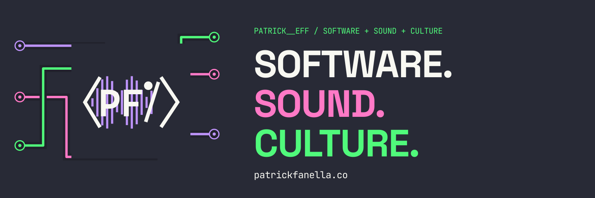

# Patrick Fanella / Patrick__eff

I'm Patrick Fanella, a senior full-stack and backend engineer in Chicago. I build web products and the systems behind them, with a focus on search, media, and tools for independent culture.

At DeliverZero, I built inventory, returns, and partner integrations across three markets, reducing manual operational work by approximately 25%. Through SUBCULT, I build products for discovering live content, researching video archives, making music visuals, and coordinating communities.

**Open to senior full-stack, backend, and product engineering roles.**

[Portfolio](https://patrickfanella.co) · [Resume](https://patrickfanella.co/resume) · [LinkedIn](https://www.linkedin.com/in/patrick-fanella/) · [Email](mailto:patrick@subcult.tv)

### Featured work

- [clpr](https://github.com/PatrickFanella/clpr) — Discover and organize Twitch clips through search, playlists, and community curation. Built with Go, React, PostgreSQL, and hybrid search, with background processing and moderation controls.
- [HasanAra](https://github.com/PatrickFanella/hasanara) — Search video archives and follow timestamped transcript passages back to the original recording. Built with FastAPI, React, GPU-backed transcription, PostgreSQL, and OpenSearch.
- [Headcount](https://github.com/PatrickFanella/headcount) — Collect and analyze Twitch viewer, follower, and chat signals through a bot-signal dashboard. Built with Go, PostgreSQL/TimescaleDB, and statistical scoring. Signals identify unusual activity; they do not prove bot use.

Product screenshots

**clpr — clip discovery**

**Undertow — layered music editor**

**HasanAra — a Rekolekt archive**

### More projects

| Project | What it does | Read more |
| --- | --- | --- |
| [Patchwork](https://github.com/PatrickFanella/patchwork) | Coordinate local mutual aid through AT Protocol accounts, requests and offers, resource discovery, scheduling, and messaging. | [Project overview](https://github.com/PatrickFanella/patchwork#patchwork) |
| [Left Field](https://github.com/PatrickFanella/left-field) | Explore seat-level election research with public records and source provenance. **In development; research scores are not forecasts.** | [Architecture](https://github.com/PatrickFanella/left-field/blob/main/ARCHITECTURE.md) · [Development](https://github.com/PatrickFanella/left-field/blob/main/DEVELOPMENT.md) |
| [Rekolekt](https://github.com/PatrickFanella/rekolekt) | Build self-hosted recording archives with timestamped transcripts, search, and links back to source video. The shared engine behind HasanAra. **Check machine transcripts against recordings before quoting.** | [Deployment](https://github.com/PatrickFanella/rekolekt/blob/main/docs/deployment/client-branding.md) · [Development](https://github.com/PatrickFanella/rekolekt/blob/main/DEVELOPMENT.md) |
| [Undertow](https://github.com/PatrickFanella/undertow) | Make music visuals by combining audio visualization, artwork, and timed lyrics in a browser editor, then export video locally. **Export support varies by browser and device.** | [Rendering](https://github.com/PatrickFanella/undertow/blob/main/docs/rendering.md) · [Development](https://github.com/PatrickFanella/undertow/blob/main/DEVELOPMENT.md) |
| [Deadweb Relay](https://github.com/PatrickFanella/deadweb-relay) | Read a small Go website as HTML, plain text, JSON, or feeds. An HTTP and discovery experiment with public notes and append-only storage. | [Implementation](https://github.com/PatrickFanella/deadweb-relay#useful-http-behavior) · [Live site](https://www2.onnwee.me/) |
| [Tadooer](https://github.com/PatrickFanella/tadooer) | Plan tasks beside a calendar, block time, and run focus sessions in a self-hosted single-owner workspace. | [Development](https://github.com/PatrickFanella/tadooer/blob/main/DEVELOPMENT.md) |
| [Kork](https://github.com/PatrickFanella/kork) | Build link pages for socials, music, media, and tip jars. Payments go directly to connected accounts. | [Project overview](https://github.com/PatrickFanella/kork#readme) |

### Developer tooling

- [Subsets](https://github.com/PatrickFanella/subsets) — discover agent skills, organize task-specific sets, and preview changes before applying them. **Alpha.**
- [T3 dev environments](https://github.com/PatrickFanella/t3-dev-environments) — isolated previews and tests scoped to Git worktrees.
- [codex-skills](https://github.com/PatrickFanella/codex-skills) — maintained agent procedures, catalogs, and guarded deployment tooling.
- [Obsidian Metronome + Tuner](https://github.com/PatrickFanella/obsidian-plugin-metronome-tuner) — timing and chromatic tuning inside Obsidian.
- Omarchy integrations: [Monitor Bar](https://github.com/PatrickFanella/omarchy-monitor-bar), [Shelfish](https://github.com/PatrickFanella/omarchy-plugin-shelfish), and [Super Productivity](https://github.com/PatrickFanella/omarchy-superproductivity).
- [Super Productivity MCP](https://github.com/PatrickFanella/super-productivity-mcp) — local task integration for agent workflows.

**Core stack:** Go · Python · TypeScript · React · PostgreSQL · PostGIS · OpenSearch · Docker · Kubernetes

Development, issues, and CI live on [SUBCULT Gitea](https://git.subcult.tv/subculture-collective). GitHub hosts public publishing copies of selected repositories.

## License

Original contributions in this repository are licensed under the GNU General
Public License, version 3 or (at your option) any later version
(`GPL-3.0-or-later`). See [LICENSE](LICENSE).

Third-party code, documentation, fonts, data, and other assets retain their own
licenses, copyright notices, and attribution. This license does not replace
those terms or grant rights to upstream material that its authors have not granted.
